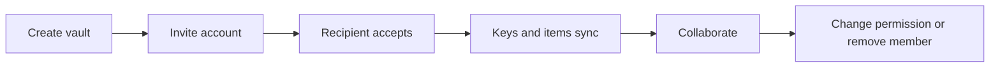

# Sharing and Collaboration

Standard Red Notes has two distinct sharing models:

- **Shared vaults** use authenticated membership and server-enforced
  permissions.
- **Public share links** intentionally give link holders access to the shared
  payload.

Choose the model before sharing. A public link is not a shortcut for a managed
team vault.





## Shared vault lifecycle

The vault creator receives administrative permission. Invitations carry one of
the permissions enforced by the syncing server:

| Permission | Intended capability |
| --- | --- |
| `read` | Read synchronized vault content without saving content changes |
| `write` | Read and edit normal vault content |
| `admin` | Manage vault-level structures and membership operations in addition to content |

Use `read` unless the recipient needs to modify content. Reserve `admin` for
people who should manage the shared space.

## Inviting a collaborator

1. Confirm that shared vaults are enabled for the account.
2. Create or open the intended vault.
3. Enter the recipient’s account identity carefully.
4. Select the minimum permission.
5. Send the invitation and wait for explicit acceptance.
6. Add only the intended notes and files.
7. Verify from a second account that the permission behaves as expected.

Invitations, acceptance, permission changes, and removal are synchronized
operations. Allow both clients to complete sync before diagnosing a missing
vault.

## Encryption and membership

Clients handle the cryptographic material needed for authorized vault members.
The server enforces membership and permission rules when accepting item
changes. This means:

- a modified client cannot turn `read` permission into accepted writes;
- removing a member blocks future authorized sync;
- moving an item between vaults changes its sharing boundary; and
- a former member may still possess plaintext or screenshots obtained while
  access was valid.

Revocation controls future access; it cannot retract knowledge.

## Realtime collaboration

Signed-in owners of ordinary notes and private-vault notes, plus shared-vault
members with current `write` or `admin` permission—including the note creator—
can join the end-to-end encrypted live relay for co-editing, presence, and
comments. The browser derives a separate non-extractable room key for every
note from the matching client-only account or vault root key. The gateway sees
room membership and message timing/size, but it relays only ciphertext and
cannot read note updates or comments.

Members with `read` permission, read-only account sessions, and read-scoped MCP
sessions cannot mint a live-room capability. They retain ordinary encrypted
sync and can view content their vault permission allows; they simply do not
receive or inject live editor, presence, or comment frames.

Room capabilities expire after 300 seconds by default and deployments may set
`COLLABORATION_CAPABILITY_TTL_SECONDS` to a whole number from 30 through 900.
The gateway refuses invalid values. A removed or downgraded member cannot renew,
and the short expiry bounds how long an already-issued capability can be replayed.
Each account may hold 16 simultaneous realtime sockets by default; operators may
set `WEBSOCKET_MAX_CONNECTIONS_PER_USER` to another positive whole number. This
allows normal tabs and devices while bounding per-account connection fan-out.

Tabs on the same build normally share a worker and its realtime socket. When
workers cannot be shared, including tabs running different builds, each worker
can open its own socket. An older tab does not reserve the entire account's
socket lane. The server still permits only one saving lease per collaborative
note; having another connection does not grant another writer that lease.

Pending saves have exclusive recovery ownership in the browser's durable
journal. Workers skip a sibling's live commands and atomically claim abandoned
commands after release or the 15-second crash timeout. Recovery retains the
original device identity, command identity, encrypted bytes and socket-only
constraint, and asks the server for the command's status before replaying it.
Commands from older builds remain recoverable; new records are namespaced so an
older worker cannot consume them. No browser database upgrade or tab census is
needed to use independent connections.

A refused socket-only upload does not pause unrelated rooms. The client retains
the refused items and waits before retrying the same proof. A new server-issued
saver proof permits an immediate retry; a delayed refusal for an older proof
cannot revoke its replacement. When another tab opens a note before this tab
knows it is collaborative, the server identifies the fenced note in its refusal.
The client protects that note from HTTP replay without pausing unrelated saves.
The shared worker also scopes a local eligibility refusal to the requesting tab
and note; it does not pause the tab that holds the valid saving proof.
A rejected collaborative body is never replayed
over HTTP. Account-wide restrictions, such as live sync being disabled or
read-only access, still apply to the whole save lane.

WebSocket delivery is best-effort; encrypted item sync holds the durable record.
A live Super note has one saving device, chosen from canonical-ready editors
whose socket save lane works. That device holds a server lease for the note.
An eligible active saver keeps that role when another editor joins or regains
connectivity. A joining or older client without an active-saver announcement
does not force a handover merely by sorting earlier in the election. If the
saver loses its socket save lane or canonical room state, another eligible
device can take over. Competing active announcements use a deterministic order;
the server lease still decides who can persist the note.
Other participants contribute through the encrypted relay without saving
competing whole-note copies. A replacement obtains the lease and retrieves
the current server revision before saving. The database serializes ownership
changes with note writes, including a save already in flight.

Live collaboration saves stay on the socket, including queued recovery after
an editor closes. After a healthy saver has been established, a connected,
canonical editor allows up to five seconds for a saver handoff without disabling
editing. This allowance does not authorize persistence: writes still require the
server saving lease. It ends immediately if the room disconnects or durability
stalls. If no participant can obtain and maintain the saving lease beyond that
allowance, the room becomes read-only until a saver returns. Editors also pause when the
server has not acknowledged the retained document state for 15 seconds.
On deployments with a collaboration gateway, eligible shared Super notes keep
their body and title read-only while joining or retrying the room. Editing starts
after the canonical document and its saving device are ready.
Ordinary notes outside live collaboration retain normal HTTP fallback. Comments
continue to use their own encrypted item sync.

Transient room preparation failures retry with a 2–30 second backoff while
the page is visible. A mounted editor retains its Yjs document through socket
outages; after five failed reconnect attempts it waits 15 seconds before another
bounded attempt cycle. Returning to the tab or recovering the socket can resume
that cycle sooner. Permission denials stop automatic retries until access or
account state changes. A changed room encryption epoch requires fresh room
preparation. None of these retries bypass the canonical-state or saving-lease
checks. Saver election coalesces presence changes for 200 milliseconds before
claiming its server lease and pulling the current revision.

After an unexpected socket disconnect, the gateway preserves an activated
room's history for up to 30 seconds, bounded by the remaining editor lease
lifetime. The disconnected lease cannot save, answer state requests, or renew
itself. A returning editor must pass authorization again, then can resume its
retained document in the same room epoch. Explicit departures and permission
revocations do not receive this grace. If the last lease expires, the next
bootstrap uses a fresh epoch rather than mixing a new text-derived document
with the old CRDT history. Long outages therefore can still require fresh room
preparation; this is not a guarantee of uninterrupted offline editing.

An eligible peer that never announces an active saving proof gets a 3-second
preparation grace period; after that another candidate may try the server
lease. Repeated presence updates do not restart that wait. An already active,
healthy saver keeps its role. Transient saver failures retry after 500
milliseconds, doubling up to 5 seconds; the one-second watchdog schedules
those retries. A rejected claim never enables editing. In-flight initialization
still has its 15-second deadline, and a crashed owner's server lease can take
up to 20 seconds to expire. These safety waits are distinct from an ordinary
connected handoff, which does not deliberately wait for lease expiry.

When a tab closes normally, the shared socket releases only the saving lease
issued to that tab. When an independent worker's socket closes, the gateway
releases its server-issued saving proofs itself, including a claim that finishes
after the connection closes. Internal leases are bound to that connection, so
delayed cleanup cannot release a replacement connection's lease even if it uses
the same editor identity. The server still checks the exact owner, device,
room epoch, lease and token under the write lock. A gateway crash, undetected
connection loss or unreachable backend retains the 20-second expiry as a fallback.

After a room has been active, brief transient recovery avoids a paused warning:
the status uses a neutral restoring indication for the first second, a subtle
reconnecting indication after that, and a paused explanation after five seconds.
An initial join, an exhausted recovery or a permission denial remains visible
immediately. This presentation grace does not claim edits are saved. The separate
five-second editing allowance above applies only to an established, connected
room during a saver handoff.
An established fixed desktop ribbon remains visible but disabled during a
connection pause, preserving its selected tab and layout. Controls remain hidden
during initial preparation; a disconnected editor does not accept new edits.

Switching notes can proceed while collaboration is paused if the retained
document has already been durably acknowledged, or the read-only editor never
accepted an edit. Pending or unverified edits keep their editor mounted.

The live relay rides the legacy socket derived from the configured sync server.
An HTTP-only participant can contribute while a socket-capable saving device
is present; it cannot become the room's saver. Only the saving device can edit
the note title, which is separate from the shared document body.

Remote carets repaint on movement, editor changes, scrolling and resizing, and
are clipped to the visible editor. Other tabs or devices on your own account
appear as separate cursors.

Selections include wrapped and multiline text, backward selections, selected
blocks, and table cells. Block and table presence carries encrypted Yjs
identities, not plaintext content or screen coordinates, and is bounded to
128 regions. Reload older open tabs after upgrading: their strict presence
validator cannot interpret the new block/table selection metadata.

### Shared-vault membership repair

Syncing-server's membership table is authoritative. Socket item sync checks
that table rather than rejecting members based on auth's replicated token
scope. Auth refreshes its copy at startup, every minute, on membership events,
and before minting a cross-service token. Reconciliation repairs missing members,
removes stale members and deleted-vault rows, and aligns permissions and survivor
flags. Events request a fresh authority read; delayed event payloads cannot
restore a removed member. An unavailable authority yields a retryable service
failure instead of a token carrying unverified grants.

Separate services use a signed internal snapshot endpoint at syncing-server's
configured `SYNCING_SERVER_URL`. Auth can override that address with
`SHARED_VAULT_MEMBERSHIP_AUTHORITY_URL`. The combined HomeServer reads authority
directly. Both services share `AUTH_JWT_SECRET` for the internal signature;
these internal endpoints should remain behind the deployment's private network.
Snapshots larger than 100,000 memberships are rejected without changing the
replica. Apply the auth membership uniqueness and replica-generation migrations,
and the syncing-server saving-lease migration, when upgrading.

### Realtime topology and Redis

The realtime gateway is not a separate service and has no container, port or
origin of its own. It runs inside the process that already answers the API — the
API gateway on the multi-container stack, the combined server process on the
all-in-one container — and the front door proxies it under `/sockets` on the same
origin as everything else.

That placement is why two collaborators served by the *same* process can be
relayed directly, and why everything Redis carries is about crossing a boundary
that one process does not have:

- shared room state, so a room lease, its epoch and its tombstone mean the same
  thing to every replica;
- the cross-replica relay for encrypted room frames and room-sync requests;
- the push bridge that tells a device something changed elsewhere;
- the worker sync lane's ticket, command-lease and socket-budget stores;
- the durable invite-event streams.

A short-lived atomic Redis lease elects exactly one initial editor bootstrapper.
Lease keys are refreshed only while the socket is alive and expire after a
bounded interval if a process disappears. Redis never receives note plaintext,
room keys, or room capabilities.

A deployment that runs exactly one gateway process keeps that same state in its
own memory instead, which is what the single container does. Multiple
API-gateway replicas **require** Redis. Keep it internal and
healthy when scaling the gateway. During a Redis outage each replica stays
fail-closed on room authorization and durable encrypted item sync keeps working,
but realtime relay is guaranteed only between clients on the same replica until
Redis recovers — which is the failure that looks like nothing at all on a small
deployment and like intermittent staleness on a large one.

Single-container and LXC deployments bundle no Redis and need none. One process
holds every socket there, so the gateway attaches with `REDIS_HOST` unset and
keeps the collaboration plane, the push bridge and the sync lane's ticket, lease
and socket-budget state in that same process. Co-editing, presence and live
comments work out of the box. Two properties follow from a plane that lives in
memory: realtime state is lost on restart, so collaborators re-discover their
rooms and resync. Clients can download persisted content over HTTP, but retained
collaboration edits require a healthy socket save lane. Editing pauses until a
device acquires the room's saving lease and refreshes its server base. Comments
continue to persist through their own encrypted item sync.

Set `REDIS_HOST` on those topologies only to run several gateway replicas against
one database. The multi-container stack ships Redis and has the relay on by
default.

If collaborators see stale content:

1. stop simultaneous edits;
2. confirm each account still has vault membership;
3. run manual sync on every client;
4. inspect conflict copies before deleting anything;
5. check WebSocket and sync service health; and
6. confirm that an administrator has not disabled realtime for the user.

## Comments and mentions

The Super editor's **Review** ribbon tab contains **Show comments** and
**New comment on selection**, **Comment indicators**, and comment purge controls.
Comments open in a separate sidebar to the right
of the document. Drag its left edge to resize it (or focus the divider and use
the arrow keys), collapse it to a narrow rail, expand it, or close it. Switching
ribbon tabs does not close the sidebar. On small screens it opens over the right
side of the document. Existing private or shared comments automatically reveal
the sidebar once when opening a note; manually closing it keeps it closed for
that editing session. The panel loads when opened; a comments rendering error
is contained in the sidebar rather than replacing the editor.
Choose the whole note or a task with **Comments for**, or click a task's
**Comments** action in the **Checklist** tab to open the sidebar for that task.
Quoted context in a comment can be clicked to jump to its referenced block or
task. Text references use the block key and a unique matching snippet as a
fallback after reopening; a missing or ambiguous reference is reported rather
than jumping to unrelated text.
Switching ribbon tabs or reconnecting the editor keeps an unfinished comment
in place while this note remains open. Closing the note or changing accounts
clears unfinished drafts. Comments start in **Private** mode:
they are stored in your personal encrypted account preferences, including when
the note belongs to a shared vault. Choose **Collaborative** explicitly to use
the note's signed, encrypted comment stream. Changing the note or comment target
returns the selector to Private. Collaborative comments follow the note's access
permissions; a private comment does not give another person access.

**Comment indicators** toggles the visual markers on referenced blocks and tasks
without hiding the comments sidebar or changing note content. The same setting
is available in **Preferences → General → Notes & editor → Comments**.

New collaborative comments and replies offer **Notify other users**. When
checked, a signed recipient marker travels inside the encrypted note; other
authorized vault members receive an in-app notification after the comment arrives
and its authorship is verified. This does not send email. The checkbox starts
unchecked; **Notify other users by default** in the Comments preferences changes
that default. Private comments never notify other users. Incoming comment alerts
can also be switched off in Notifications preferences.

**Purge my comments** removes your private comments and your authored shared
comments from this note, preserving shared replies written by other people.
The note or shared-vault owner additionally has **Purge all comments**, which
removes all shared comments on the note and that owner's private comments.
Neither operation reads or removes another account's private comments. Both
require confirmation. Shared purges use signed removals and an atomic encrypted
local checkpoint before ordinary sync distributes them; ownership is checked
again when the mutation executes.

Switching notes does not wait for a remote collaboration saver. When the outgoing
document still has changes awaiting acknowledgment, its exact editor stays mounted
in a hidden background tab marked **Pending sync** while the new note opens. It
is released only once the room's persisted server revision covers its retained
state. A local persistence failure still stops the switch. Server save fences and
authorization checks remain in force; a retained editor is not a claim that its
changes have already synced.

Private comments sync as separate account-encrypted records and appear in encrypted
account backups. They never enter a shared vault. Updates from different devices
merge by comment identity; deletion wins over stale offline edits. Purging removes
comments observed by that device, preserving new comments it has not received yet.

The limits remain 256 notes, 256 comments per note and 64 replies per thread.
Operation history has a 32 MiB content budget and a separate deletion reserve.
Compaction checkpoints the surviving comments and deletion markers, then removes
unchanged old records only after the replacement is acknowledged by the server.
Failed cleanup preserves originals. Deletion markers remain to prevent offline
copies from resurrecting removed comments. Full or unreadable storage produces an
error instead of overwriting history.

Existing version-1 preference comments are imported on mutation; the old preference
is retained as a recovery backup. Consequently, purging is not secure erasure of
that legacy backup. Already lost preference changes cannot be reconstructed.
Deploy the matching app and server together for this new content type.
Older app versions must refresh to display and edit the new records. Private
comments use ordinary encrypted account sync, not the shared comment stream.

A saver claim includes the server's committed note revision, read under the
same SQL lock that protects writes. If the local note is clean and matches that
revision, startup does not queue another account-wide sync. A different or
missing revision still requires a read-only catchup. Older servers remain
compatible through that catchup path. A timed-out initialization releases its
proof and retries; late completion cannot replace a newer saver. Retries reuse
an unfinished catchup instead of adding more requests to the account queue.

Once a live room is editable, its saver checkpoints the latest document within
a 350 ms batching window, including during continuous typing. These checkpoints
bypass the ordinary editor's additional 700 ms save debounce and enter the
existing fenced socket queue. The separate upload throttle for notes over
1.5 MB still applies. Encryption, queued work, network latency and the server
commit still take time; a checkpoint is only considered saved after the server
acknowledges it. Lifecycle flushes still capture the final pending edit.

The **Checklist** ribbon tab appears when the note contains a checklist and
provides completion controls, recurrence settings, pins and high, normal or low priority flags.
Place the cursor in an item to configure it using the compact **Item settings**
ribbon group; the ribbon does not duplicate the checklist as a task list.
Tasks use **Single tick** by default: one shared completion checkbox. To make an
item multi-tick, change its completion mode in the **Checklist** ribbon to
**Per person (multi-tick)**. Its checkbox now completes the item for you only;
each collaborator has their own tick. **Ticked by** lists the people who have
ticked it, including people currently offline. Each multi-tick item also shows
a small tick-count badge beside its text, even when the ribbon is closed. Unticking removes only your tick. Personal ticks are
saved in the encrypted note and synchronize between collaborators and your own
devices. They do not advance a shared recurring schedule. Switching back to
Single tick restores shared completion; personal ticks are retained if you later
switch the item back to Per person.
Pinned items and high- or low-priority items show compact labels beside their
text. Changing these settings does not rearrange the note. Flags remain attached to the task through saving and reopening; portable
text and document exports include labels for pins and non-default priorities.

Mention candidates are derived from shared-vault users, and display names are
resolved by the client. A mention does not grant access. If a person is not a
member of the vault, mentioning them must not be treated as an invitation or
permission change.

## Public share links

Public shares are suited to publishing or sending a bounded item to someone who
does not have a Standard Red Notes account. Anyone who obtains a valid link may
be able to retrieve the shared data.

Before creating a link:

- remove unrelated content and attachments;
- understand whether the link expires;
- decide whether one-time burn behavior is appropriate;
- assume the recipient can save a copy;
- avoid placing the link in searchable or broadly logged channels; and
- revoke the link when its purpose ends.

Burn-after-reading behavior makes the first successful retrieval significant.
Do not use it for the only copy of important information, and use a separate
channel to confirm that the intended recipient consumed it.

## Survivor designation and removal

The member UI exposes **Designate survivor**, not a general manual ownership
transfer. If the vault owner’s account is later deleted, ownership passes to
that designated survivor. Deleting the vault itself does not trigger a transfer;
it deletes the vault.

Before deleting an owner account or removing members:

1. create an encrypted account export;
2. add the intended survivor and verify they can open representative notes and
   files;
3. use **Designate survivor** in the vault member UI;
4. confirm pending invitations and current permissions;
5. sync from two independent clients; and
6. only then delete the owner account, if account deletion is truly intended.

Member removal and vault deletion remain separate high-impact operations.
Neither can retract plaintext a former member already copied.

## Operational controls

An administrator can enable shared-vault creation per user. That entitlement is
separate from membership inside a particular vault. Admin user-management
actions are described in [Administration](administration.md).

For conflict handling and deletion semantics, see [Sync and Data
Lifecycle](sync-and-data-lifecycle.md). For link and credential risk, see
[Security and Account](security-and-account.md).
